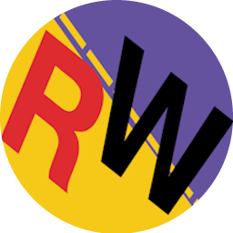
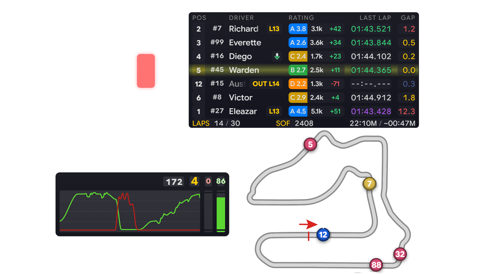

RedWave Overlays is a desktop app for iRacing drivers that shows live telemetry as clean, customizable on-screen overlays.  
It runs locally, stays lightweight, and is free to use.

##

##

<h3> Installation</h3>

1. Go to the <a href="https://github.com/onesch/redwave-overlays/releases">Latest Release</a>.

2. Download the latest installer.

3. Run it and launch the app.

<h3> Issues</h3>

  Found a bug or have a question?
  <a href="https://github.com/onesch/redwave-overlays/issues">Open an Issue</a>.

Feature requests, bug reports, and questions are welcome!

<h3> Contributing</h3>

Contributions are welcome!

  Read the <a href="https://github.com/onesch/redwave-overlays/blob/master/docs/CONTRIBUTING.md">Contributing Guide</a> for details.

<h3> License</h3>

  Distributed under the <a href="LICENSE">GPL-3.0 License</a>.

© 2026 onesch. All rights reserved.

